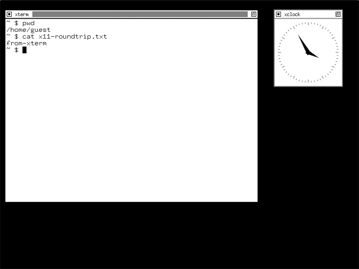

# Linux X11 for WebOS

A separate graphical Linux guest for v86. The guest runs Debian's Xorg with kernel modesetting, the twm window manager, xclock, and an xterm shell under UID 1000. The emulator receives keyboard and pointer input in the app's own document. The guest image boots locally with loopback and mounts its home through VirtIO 9P.

## Build the guest

The sibling WebOS `apps/linux` repository supplies the base initramfs and kernel listed in `base.sha256`. The desktop serves the matching v86 runtime and BIOS from `/assets/terminal/v86/`. Set up APT with signed Debian Bookworm and Bookworm Security i386 indexes that carry the versions in `packages.sha256`. For archived versions, use a signed Debian snapshot carrying those packages. You can point `APT_CONFIG` to an isolated configuration.

From this repository, with Python 3.11 or later, dpkg-deb and modinfo installed, run

```sh
python3 scripts/fetch-packages.py .build/packages
python3 scripts/build-image.py .build/packages ../linux/assets/terminal/v2/*.cpio.gz ../linux/runtime/vmlinuz .build/graphics.cpio.gz
```

The build checks every input hash and compares the module package's embedded kernel with the emulator's kernel. It assembles the filesystem as an ordinary user. It never executes Debian maintainer scripts. Package copyright notices are retained in the guest.

## WebOS entry

Serve `app.mjs`, `session.html`, `session.js`, `screen.css` and the generated `graphics.cpio.gz` together. Import `mount` from `app.mjs` and call it with the normal WebOS host. It returns `{ element, dispose, focus }` synchronously. Signed sessions use the desktop account file context and the shared Storage and Linux 9P adapters. The guest receives file operations scoped to its home. The account credential stays outside the emulator.

## Browser verification

In a local WebOS desktop backed by its real accounts server, a disposable user launched Linux X11 from Programming, clicked the xterm, typed shell commands, and saved a file in their home directory. A fresh login read the same bytes after the window closed. The shell reported UID 1000. Localhost responded and the guest routing table contained no default route.


