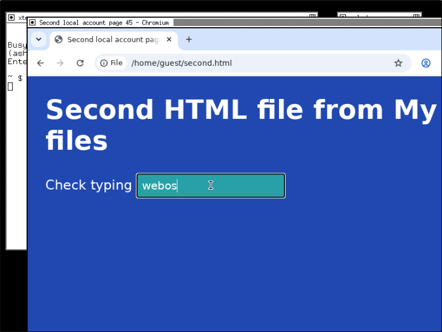

# Linux X11 for WebOS

A separate graphical Linux guest for v86. The guest runs Debian's Xorg with kernel modesetting, the twm window manager, xclock, and an xterm shell under UID 1000. The emulator receives keyboard and pointer input in the app's own document. The guest image boots locally with loopback and mounts its home through VirtIO 9P.

## Build the guest

The sibling WebOS `apps/linux` repository supplies the base initramfs and kernel listed in `base.sha256`. The desktop serves the matching v86 runtime and BIOS from `/assets/terminal/v86/`. Set up APT with signed Debian Bookworm and Bookworm Security i386 indexes that carry the versions in `packages.sha256`. For archived versions, use a signed Debian snapshot carrying those packages. You can point `APT_CONFIG` to an isolated configuration.

From this repository, with Python 3.11 or later, dpkg-deb and modinfo installed, run

```sh
python3 scripts/fetch-packages.py .build/packages
python3 scripts/build-image.py .build/packages ../linux/assets/terminal/v2/*.cpio.gz ../linux/runtime/vmlinuz .build/graphics.cpio.gz
```

The build checks every input hash and compares the module package's embedded kernel with the emulator's kernel. It assembles the filesystem as an ordinary user. It never executes Debian maintainer scripts. Package copyright notices are retained in the guest. The [Debian source inventory](docs/debian-sources.json) lists the matching source versions, download URLs and SHA-256 hashes for the locked Debian packages.

## Chromium in X11

From xterm, run `chromium` or open a saved HTML file with `chromium file:///home/guest/index.html`. This is Debian Chromium 156.0.8078.79 for i386 running inside the guest. On the tested emulated CPU, the first page can take several minutes to paint. Relative links and JavaScript work in local HTML projects. The Chrome profile and cache are temporary. The guest boots with loopback networking.

To rebuild the optional browser package, use Python 3.11 or later, Debian dpkg-deb and squashfs-tools 4.6.1. Download the Debian packages listed in `chromium-packages.json` to a directory using their recorded filenames. The URLs, sizes and SHA-256 digests are pinned. An archived package with the same digest works when a Debian mirror changes. From the app root, run

```sh
python3 scripts/build-chromium-disk.py .build/chromium-debs .build/chromium-inputs
```

The script verifies and emits both the block-aligned `browser.sqfs` and `chromium-copyright.txt`. At runtime v86 fetches 256 KiB blocks from the same origin. The disk recipe extracts the 120 copyright files shipped directly by its 121 packages. Debian's libncursesw6 points to libtinfo6 for its notice. The release serves the matching ncurses 6.4-4 source package's verified debian/copyright at `/assets/legal/linux-x11/ncurses-copyright.txt`. It includes the referenced Debian license texts in `debian-common-licenses.txt`. The Debian source inventory is served at `/assets/legal/linux-x11/chromium-source-packages.json`. [Source packages and checksums](docs/chromium-source-packages.json)

For `v86-chromium.wasm` and the X11 input controller in `v86-chromium.js`, check out the `engineCommit` in `chromium-runtime.json` from the WebOS v86 engine. The reproducible build used Node 24.22.1, Clang 18 as `clang`, GNU Make and Rust nightly-2026-11-16 with the `wasm32-unknown-unknown` target. In that engine checkout, run

```sh
mkdir -p build src/rust/gen
RUSTUP_TOOLCHAIN=nightly-2026-11-16 make -j3 build/v86.wasm
make build/libv86.js
node tests/devices/ps2_input_order.js
```

The JavaScript build uses the Makefile’s pinned Closure Compiler v20210601 and Java 17. Copy `build/libv86.js` into `.build/chromium-inputs/v86-chromium.js` and `build/v86.wasm` into `.build/chromium-inputs/v86-chromium.wasm` in the app. In the WebOS viewer build, select both `--linux-x11-packages` (the Xorg package directory) and `--linux-x11-chromium-inputs` (the Chromium output directory) with the account-home Terminal runtime. The builder verifies each artifact and the checked-out engine commit. [WebOS v86 source](https://github.com/CC-David-CC/engine-v86/tree/9019aa65bf60578fb342830b36315e466d39fb51)

## WebOS entry

Serve `app.mjs`, `session.html`, `session.js`, `screen.css` and the generated `graphics.cpio.gz` together. Import `mount` from `app.mjs` and call it with the normal WebOS host. It returns `{ element, dispose, focus }` synchronously. The desktop supplies the Files workspace for the active session. Anon uses browser-only My files. Signed-in sessions use the account's My files. Both use the shared Storage and Linux 9P adapters. The guest receives file operations scoped to its home. The account credential stays outside the emulator.

## Browser verification

On [ksu.codes](https://ksu.codes), open **Programming → Linux X11**. In Chromium, a disposable account launched the guest, clicked xterm, and saved a file as UID 1000. A fresh browser login read the exact bytes after the window closed. A separate anonymous session wrote to its temporary home. Both guests had loopback connectivity only. The screenshot below is from the signed-in production run.


The Chromium-enabled package was also checked in the WebOS desktop on a private development server with the normal browser security policy. Anon opened two HTML pages from browser-only My files, followed a relative link and typed into the second page, which ran JavaScript. Registering a new account preserved an X11 file whose writer still held its descriptor open. The screenshot shows the guest browser after typing.


