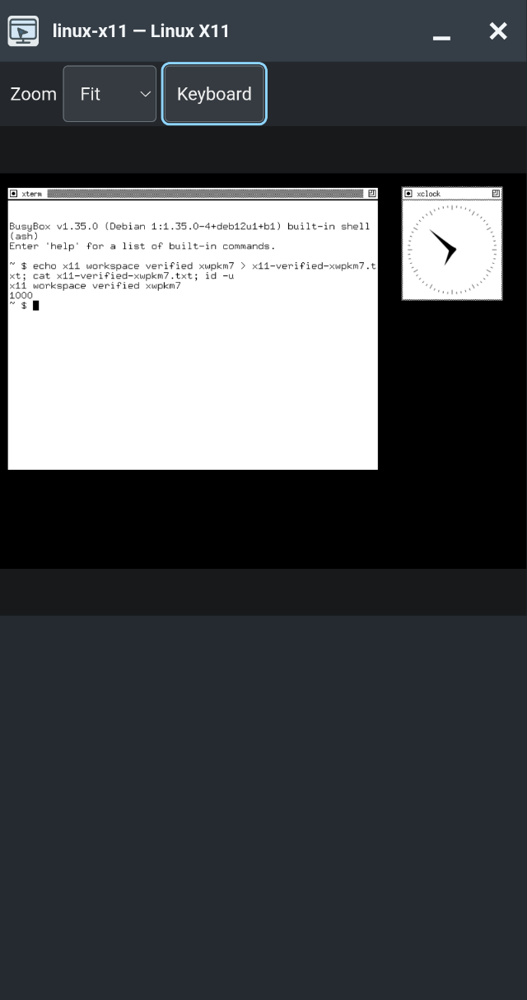
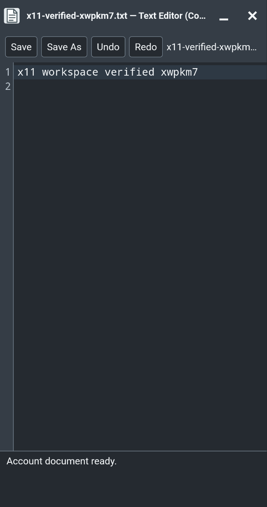

# Linux X11 on WebOS

November 26, 2026. Tested with Chrome 158.0.8127.92 on the physical Galaxy S10+ at 411 CSS pixels. Isolated Chromium 158.0.8127.36 checked the desktop flow. The baseline is xclock, interactive xterm and the guest home file cycle. General X11 application use is stretch work.

## Use xclock, xterm and My files

1. Open **Programming → Linux X11**. Wait for **xterm** and **xclock** to open. On the test phone, cold starts took a little over two minutes.
2. Use **Fit** to view both windows. On the S10+, it uses the full 411 CSS-pixel viewport. At **100%**, the 800-pixel Linux display keeps its original text size. Turn **Pan** on to swipe to the part you need. Turn it off to interact with a guest window.
3. Tap xterm and then **Keyboard** on the phone. Type a simple command and press Enter. On desktop, click xterm and type with the hardware keyboard.

   ```sh
   echo x11 workspace verified > x11-note.txt
   cat x11-note.txt
   id -u
   ```

4. Close Linux X11 and open **My files**. Open `x11-note.txt` in Text Editor. While signed in, reopen from a fresh sign-in to verify persistence. Guest files are available in the current temporary workspace. Download the result before ending the guest session.

The S10+ verified 100% zoom and touch panning, the on-screen keyboard, the exact file content and a fresh signed-in reopen. The session exposed xterm as UID 1000. The width fix treats the Zoom menu as CSS pixels, including on a phone with a fractional device-pixel ratio.





## Scope of this replay

| Workflow | Physical S10+ | Desktop Chromium |
| --- | --- | --- |
| Boot the real X11 guest and see xterm and xclock | Passed | Passed |
| Type in native xterm and read back shell output | Passed | Passed |
| Fit and inspect the graphical viewport | Fit, 100% zoom and touch pan passed | Fit at 1300 and 820 CSS pixels |
| Open a guest file after closing the X11 window | Passed | Pending |
| Reopen signed-in Linux work from My files in a fresh session | Passed | Passed |
| Run a broader mix of graphical Linux programs | Stretch | Stretch |
| Browse local HTML projects in the guest Chromium package | Stretch | Stretch |
| Qualify networked guest apps and concurrent X11 windows | Stretch | Stretch |

Five of eight phone and four of eight desktop workflow groups passed. Desktop remains at Working partial for the wider app. See the README for earlier guest Chromium and account-transfer testing.

## Source and release

Build inputs are `app.mjs`, `session.html`, `session.js` and `screen.css`, with the pinned Xorg image and v86 runtime described in the [README](../../README.md). The scoped release retains the existing Linux, Chromium and v86 assets and their notices. Only the X11 viewport script changed. Runtime source `d64d9a87947bf5ee3c4c2abdfe9ad84ae5af4ffc`. Viewer `60e3e542c4f9a101ee16265ff57045f8a54ab3770192b01f645cfeee7caf93d9`.
